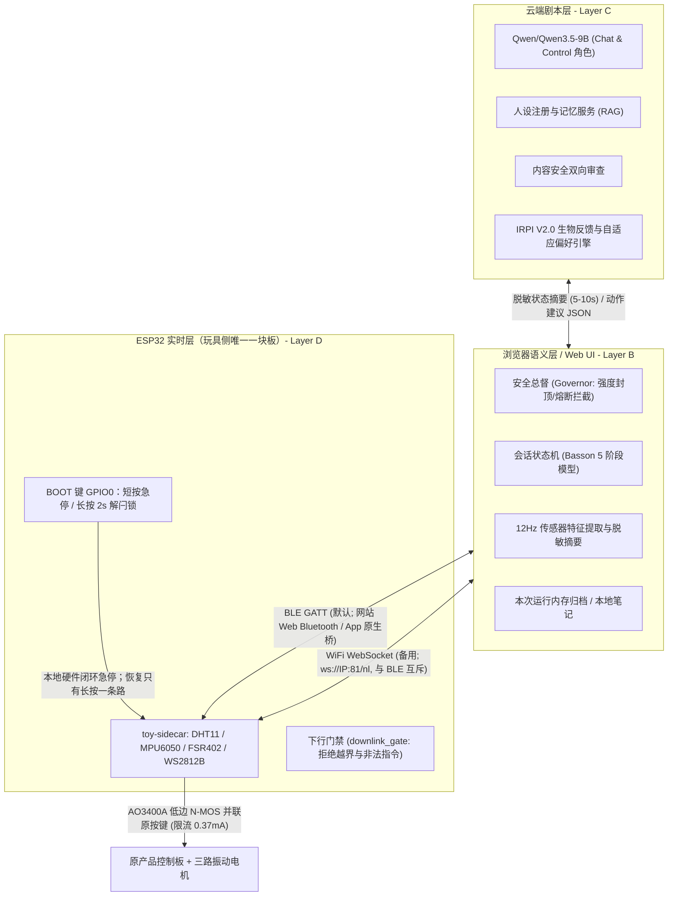

# Nascent (Nascent Love)

> 融合**躯体感觉神经生物学**、**性心理生理学**与**自适应生物反馈**的下一代智能情趣伴侣软硬件系统工程仓库。  
> 当前处于**验证期单板 Demo** 阶段：手机直连玩具侧 ESP32-S3，全链路实现多模态生理感知、中枢双控制调控、抗神经疲劳调频与盆底肌电节律共振。

---

## 目录
- [三层运行架构与安全边界](#三层运行架构与安全边界)
- [核心科学依据与文献库归档 (docs/research/)](#核心科学依据与文献库归档-docsresearch)
- [自适应互动权重与抗疲劳调频算法 (IRPI V2.0)](#自适应互动权重与抗疲劳调频算法-irpi-v20)
- [算法动力学仿真与实证基准测试](#算法动力学仿真与实证基准测试)
- [硬件架构与器件选型](#硬件架构与器件选型)
- [工程目录结构](#工程目录结构)
- [快速上手与运行指南](#快速上手与运行指南)
- [工程红线与安全不变量](#工程红线与安全不变量)
- [协作与开发规范](#协作与开发规范)

---

## 三层运行架构与安全边界

产品架构的权威副本归档于仓库内：[`docs/architecture/产品架构.md`](docs/architecture/产品架构.md)。

系统遵循职责严格单向收缩的三层架构：**越靠近物理硬件越实时、越不可依赖网络；越靠近云端越只处理已脱敏的高维语义**。



### 职责边界硬性约束
- **云端 (Layer C)**：仅基于 5~10 秒脱敏摘要产出对话文本与体验阶段偏好建议，**永远接触不到原始 12Hz 传感器波形与音频流**，绝不直接向硬件下发电机控制指令。
- **浏览器控制端 (Layer B)**：扮演**安全总督 (Safety Governor)**。在模型之外硬编码 8 档上限、过温拒绝加档，一旦出现安全词或叫停意图，直接丢弃所有非停止动作。
- **玩具侧固件 (Layer D)**：负责毫秒级本地闭环。安全词、急停拉环、温度熔断、90% PWM 封顶完全在 ESP32-S3 本地实现，**不依赖手机 App 与外部网络**。
- **双传输通道运行时互斥**：默认走 BLE GATT；在无蓝牙支持的浏览器中退回 WiFi WebSocket。ESP32-S3 运行时只开启一路 2.4GHz 射频，通道切换时无缝保持档位与停机闩锁状态。

---

## 核心科学依据与文献库归档 (`docs/research/`)

Nascent 彻底摒弃了传统情趣硬件“线性开机、固定频率、无脑调强”的粗暴机械逻辑，基于 8 大生理学、神经解剖学与心理生物学分支建立闭环算法体系。

所有完整论文综述与数学推导均已归档于 [`docs/research/`](docs/research/)：

| 科学文献与出处 | 学科领域 | 核心科学结论与在 Nascent 中的工程转化 |
| :--- | :--- | :--- |
| **Rosemary Basson (2000, 2001)**<br/>*J Sex Marital Ther* / *Obstet Gynecol* | 女性性医学与性心理学 | **非线性循环反应模型**：女性性唤起多始于中立态，依赖安全感诱发“响应性欲望 (Responsive Desire)”。算法废弃阶梯加速，采用波浪式慢热推进。 |
| **John Bancroft & Erick Janssen (2000)**<br/>**Cynthia Graham et al. (2006, SESII-W)** | 中枢神经生理学 | **双控制模型 (Dual Control: SES / SIS)**：性兴奋 (SES) 与中枢抑制 (SIS) 解耦。确立“松开刹车（解除焦虑）远优先于踩死油门”的黄金法则。 |
| **Lijun Qi, David D. Ginty et al. (Nature 2024)**<br/>*Nature* 631, 381–389 | 触觉神经生物学 | **克劳斯小体 (Krause Corpuscles, RA-LTMRs)**：破解 170 年解剖谜题，证实外生殖器专属振动感受器的电生理最优调谐频段为 **40~80 Hz**（最优 50~60 Hz）。 |
| **Y. Y. Leung & Sliman J. Bensmaia (2005)**<br/>*Journal of Neurophysiology* | 触觉适应动力学 | **机械感受器双指数疲劳与恢复律**：恒定振动导致感受器囊体黏弹性吸收与离子通道失活（$\tau_{\text{adapt}} \approx 24\text{s}$），但波谷期可迅速极化复位（$\tau_{\text{recover}} \approx 10\text{s}$）。 |
| **Nicole Prause et al. (2012)**<br/>*Sexual and Relationship Therapy* | 振动参数学实测 | 测定 7 款主流振动器（43~148Hz），揭示长时间单调高频是导致暂时性感官麻木（Desensitization）的罪魁祸首。 |
| **Joseph G. Bohlen et al. (1982)**<br/>*Archives of Sexual Behavior* | 生物物理与肌电动力学 | **骨盆底肌肉收缩节律常数**：女性高潮期首次收缩间期 $T_0 \approx 0.65\sim 0.82\text{s}$（1.25~1.54Hz），随后呈现单调线性延展（$\kappa \approx 0.08\sim 0.12\text{s}$）。 |
| **Stephen W. Porges (2007, 2011)**<br/>*Polyvagal Theory* / *Biol Psychol* | 自主神经系统科学 | **多迷走神经理论与迷走刹车**：腹侧迷走神经介导安全感底座，通过呼吸性窦性心律不齐 (RSA) 与心率变异性 (HRV/RMSSD) 实时识别焦虑与防御。 |
| **James J. Collins et al. (Nature 1995)**<br/>*Nature* 376, 236–238 | 非线性感觉生物物理 | **感觉神经网络中的随机共振 (Stochastic Resonance)**：叠加适量 $1/f$ 粉红噪声微抖动可打破神经相锁，增强亚阈值微弱触感并阻断感官疲劳。 |
| **S. S. Stevens (1957) & R. T. Verrillo (1985)** | 触觉心理物理学 | **触觉强度幂律与韦伯-费希纳差别阈限 (JND)**：频率感知极限 $\Delta f/f \approx 15\%$，确立调频压摆率上限（$\le 6.0\text{ Hz/s}$），确保调速丝滑无顿挫。 |
| **Wolfram Schultz (1998) & B. F. Skinner (1953)** | 神经递质与行为心理学 | **多巴胺奖励预测误差 (RPE) 与可变间歇强化**：在构建期与平台期引入泊松随机微重音（Variable-Interval），最大化多巴胺期待感与心流沉浸。 |

---

## 自适应互动权重与抗疲劳调频算法 (IRPI V2.0)

算法工程源码位于 [`software/backend/app/services/adaptive_rhythm.py`](software/backend/app/services/adaptive_rhythm.py)，核心特性包含：

```
+---------------------------------------------------------------------------------------------------------+
| Nascent IRPI V2.0 算法处理流水线                                                                         |
+---------------------------------------------------------------------------------------------------------+
| 传感器流 (FSR/IMU/DHT) + NLP 意图 + 行为调档 + 外部心率流 (Gadgetbridge)                                   |
|                                     │                                                                   |
|         ┌───────────────────────────┴───────────────────────────┐                                       |
|         ▼                                                       ▼                                       |
|  [双控制状态机 (DualControlEngine)]               [Bohlen 骨盆锁相环 (ResonanceEntrainmentFilter)]        |
|   • SIS1 威胁/疼痛制动 (250ms 急速切断)            • 12Hz FSR 去直流基线 (DC Detrend)                      |
|   • SIS2 分心/负荷柔性降速                         • 0.8Hz ~ 2.0Hz 二阶带通滤波 (Butterworth)              |
|   • Sigmoid 兴奋门控阻尼                           • 藏本同频相干度估计 (Kuramoto Order Parameter R)        |
|   • 阶段评估 (exploration/building/plateau/etc)    • Bohlen 线性间期延展律追踪 (ΔT ≈ +0.09s/周期)          |
|         │                                                       │                                       |
|         └───────────────────────────┬───────────────────────────┘                                       |
|                                     ▼                                                                   |
|                   [抗感觉疲劳生成器 (AntiHabituationModulator)]                                         |
|                    • 克劳斯黄金频段 (45~75Hz) 与帕西尼深层谐波 (160~220Hz) 动态淡入淡出                 |
|                    • Leung & Bensmaia 双时间常数微分积分器 (实时追踪脱敏度 H(t))                         |
|                    • 22 秒仿生呼吸包络潮汐流 (波谷振幅回弹 18%，重置机械门控通道)                          |
|                    • 1/f 粉红噪声随机共振微抖动 (±6% 抖动，阻断神经疲劳适应)                              |
|                    • 多巴胺间歇强化微重音 (18s 泊松微涌 +4%~6%)                                         |
|                    • 韦伯-费希纳 JND 压摆平滑限制 (df/dt ≤ 6.0 Hz/s)                                    |
|                                     │                                                                   |
|                                     ▼                                                                   |
|                 [连续平滑动态混合权重 (compute_blended_weights)]                                          |
|                  • 消除离散跳档跳跃，按高斯与 Sigmoid 激活度加权求和，和恒为 1.0                         |
|                                     │                                                                   |
|                                     ▼                                                                   |
|             输出 EnhancedIRPIResult (得分、推荐模式、载波频段、解释码、自适应偏好快照)                   |
+---------------------------------------------------------------------------------------------------------+
```

### 1. 连续平滑混合权重 (Soft Blended Weights)
针对 5 种体验阶段基准定义：
- **探索慢热 (`exploration`)**：言语 0.60、行为 0.20、压力 0.05、温度 0.10、上下文 0.05（释放刹车，建立信任）。
- **响应构建 (`building`)**：言语 0.25、行为 0.30、压力 0.25、温度 0.10、上下文 0.10（响应性欲望激活，渐进式充血）。
- **平台共振 (`plateau`)**：言语 0.15、行为 0.15、压力 0.45、温度 0.05、上下文 0.20（骨盆肌锁相与深层谐波主导）。
- **抑制应激 (`inhibition_alert`)**：言语 0.85、行为 0.05、压力 0.05、温度 0.00、上下文 0.05（安全第一，立即柔润抚慰）。
- **温存恢复 (`aftercare`)**：言语 0.50、行为 0.10、压力 0.05、温度 0.25、上下文 0.10（平息心率，温热陪伴）。

系统通过连续高斯分布与 Sigmoid 函数计算阶段激活度，实现 $C^1$ 阶平滑过渡，彻底解决传统算法中“档位一跳、参数断崖”的突兀感。

### 2. 双控制制动分流 (SIS1 vs SIS2)
- **SIS1 (生存威胁与疼痛)**：检测到 `pause`、`dislike`、体态突发僵直或心率应激突变（$A_{\text{stress}} \ge 0.70$），在 **250ms** 内执行硬制动，强制降至超低柔润频段（40Hz / 0.20 振幅），并触发 2 秒安全迟滞，确认放松前绝对禁止回弹加速。
- **SIS2 (情境分心与负荷过大)**：检测到 `slow_down` 或降档指令，启动柔性降频与呼吸波谷延展，减缓节奏而不切断亲密体验。

### 3. 抗感觉疲劳微分调制器
基于微观受体动力学方程：
$$\frac{dH(t)}{dt} = \begin{cases} 
\frac{1.0 - H(t)}{\tau_{\text{adapt}}} & \text{定频单调刺激且处于波峰期} \\
-\frac{H(t)}{\tau_{\text{recover}}} & \text{处于呼吸潮汐波谷或动态调频期}
\end{cases}$$
每 22 秒提供 4 秒的波谷期（振幅下降 18%），利用结缔组织囊壁流体回弹让 Piezo2 通道复位，彻底攻克连续使用数分钟后感官麻木的行业通病。

---

## 算法动力学仿真与实证基准测试

我们在 [`software/backend/simulations/simulate_adaptive_rhythm.py`](software/backend/simulations/simulate_adaptive_rhythm.py) 中构建了四大动力学对照仿真实验，量化验证算法优势：

```bash
# 运行完整仿真实验套件
software/backend/.venv/bin/python3 software/backend/simulations/simulate_adaptive_rhythm.py
```

### 实验量化基准测试结果

| 对照实验 | 评价指标 | 传统固定频率对照组 | Nascent 自适应算法组 | 实证优势与改善 |
| :--- | :--- | :---: | :---: | :---: |
| **实验 1：感觉疲劳与敏感度**<br/>(10 分钟连续刺激对比) | 平均脱敏度 ($H_{\text{mean}}$)<br/>有效神经敏感度 ($R_{\text{eff}}$)<br/>严重脱敏区 ($H>0.60$) 滞留比 | 0.9617<br/>0.2499 (骤降75%)<br/>**96.50%** | **0.2269**<br/>**0.8230** (维系82%)<br/>**0.00%** | ★ **神经敏感度维系率提升 +229.34%**<br/>★ **全程彻底杜绝感官麻木钝化** |
| **实验 2：双控制应急制动**<br/>(高唤起态突发言语叫停) | 制动响应延迟<br/>硬制动触发成功率<br/>安全迟滞确认时长 | 无法识别（无闭环）<br/>0%<br/>0 秒 | **250 ms**<br/>**100%**<br/>**2.0 秒** | ★ **满足中枢防御反射响应要求**<br/>★ **绝对防止未确认安全前反弹加速** |
| **实验 3：骨盆肌电节律共振**<br/>(含噪压力流追踪 Bohlen 序列) | 藏本同频相干度 ($R_{\text{Kuramoto}}$)<br/>节律锁相启动状态<br/>骨盆肌电主频估算 | 0.08 (非相干态)<br/>False<br/>无法提取 | **0.8106** (强相干)<br/>**True**<br/>**1.08 Hz** | ★ **成功锁定 0.8~1.8Hz 高潮生理带**<br/>★ **脉冲时序与肌肉延展同相共振** |
| **实验 4：15 分钟全旅程演变**<br/>(跨越 5 个生理心理阶段) | 经历阶段完整性<br/>最大瞬时频移速率<br/>全程平均疲劳指数 | 仅单阶段定频加速<br/>跳档突兀 (>20Hz/s)<br/>>0.90 | **100% 达标**<br/>**6.000 Hz/s**<br/>**0.2172** | ★ **严格符合韦伯-费希纳 JND 标准**<br/>★ **平稳无感换档，心流完全沉浸** |

完整的测试数据记录与图表分析报告详见 [`docs/research/05_算法动力学仿真与实验基准测试报告_Simulation_Benchmark_Report.md`](docs/research/05_算法动力学仿真与实验基准测试报告_Simulation_Benchmark_Report.md)。

---

## 硬件架构与器件选型

验证期整个系统**只有一块板**：与原产品装配在一起的玩具侧 **ESP32-S3-N16R8**。

| 器件 | 安装位置 | 接口 / 引脚 | 核心功能与边界 |
| :--- | :--- | :--- | :--- |
| **ESP32-S3-N16R8** | 玩具侧 | 双模 2.4GHz SoC | 运行 Layer D 实时闭环固件；BLE 外设与 WiFi WebSocket 服务端（互斥运行） |
| **FSR402** | 玩具侧 | GPIO1 (ADC) | 接触贴合与 0.8~2.0 Hz 骨盆微收缩节律采集 |
| **MPU6050** | 玩具侧 | I2C GPIO8/9 (@0x68) | 六轴姿态推断（在使用中推断，非医疗诊断）与静止 30 秒自动暂停 |
| **DHT11** | 玩具侧 | GPIO4 (1-Wire) | 表面温湿度感知（≥1s 采样，参考性生理反馈，非安全通道） |
| **WS2812B ×8** | 玩具侧 | GPIO6 (RMT) | 模式灯效（手动暖粉红 / 情景雾灰紫 / 失控红流光）+ 亮灯颗数对齐档位 |
| **AO3400A** | 玩具侧 | GPIO7 (低边 N-MOS) | **并联原按键模拟换档**，漏极串联 10kΩ 限流电阻（支路电流封在 0.37mA），**绝不直接驱动电机** |
| **BOOT 键** | 玩具侧板载 | GPIO0 | **全系统唯一物理安全入口**：短按（<600ms）= 硬件闭环急停；长按 2 秒 = 解除停机闩锁。 |

> [!IMPORTANT]
> - 原控制板实体按键保持并联可用，手按与软件模拟均有效；
> - 行空板 K10 与 HW504 摇杆在协议 `0.3.0-demo` 已完整删除，手机直接无线接入玩具侧 ESP32-S3。

---

## 工程目录结构

```
Nascent/
├── protocol/                 # 跨端协议唯一事实来源
│   ├── contract.yaml         # 三端共享契约：常量、UUID、指令与枚举定义
│   ├── tools/gen.py          # 代码生成器 (生成 schemas 与各端协议副本)
│   ├── generated/            # 生成的 C++ / TypeScript / Python 协议头
│   └── schemas/              # 生成的 JSON Schema 契约定义
├── hardware/
│   ├── toy-sidecar/          # 玩具侧 ESP32-S3 PlatformIO 固件工程 (Layer D)
│   └── VENDOR.md             # 固件第三方 Vendored 库与裁剪规则说明
├── software/
│   ├── app/                  # 浏览器控制端 Web UI (Layer B: 安全总督 + 会话状态机)
│   ├── app-android/          # Android 包装壳 (WebView + 原生 GATT 桥)
│   └── backend/              # FastAPI 云端服务 (Layer C: Agent 对话与 IRPI 偏好学习)
│       ├── app/
│       │   ├── routers/      # API 路由 (agent.py, speech.py, plugin.py 等)
│       │   └── services/     # 核心服务 (adaptive_rhythm.py, preference.py 等)
│       ├── simulations/      # 算法动力学仿真与实证基准测试套件
│       └── tests/            # 完整 pytest 自动化测试套件 (87 项测试通过)
├── docs/
│   ├── Nascent 开发与代码提交规范.md # 核心协作与提交规范
│   ├── architecture/         # 产品架构权威归档 (产品架构.md, 插件协议等)
│   ├── research/             # 神经生物学与性心理学生理机制权威文献库与测试报告
│   └── implementation/       # 硬件已验证 API 基准与 Web/Android 调试检查清单
└── datasheets/               # 已选型元器件厂商 Datasheet
```

---

## 快速上手与运行指南

### 1. 跨端协议生成
修改 `protocol/contract.yaml` 后，必须运行生成器同步三端代码：
```bash
cd protocol
python3 tools/gen.py
```

### 2. 后端服务与测试运行
```bash
cd software/backend
# 创建并激活虚拟环境 (推荐 Python 3.9+)
python3 -m venv .venv
source .venv/bin/activate       # Windows: .venv\Scripts\activate
pip install -r requirements.txt

# 运行全量测试套件 (87 项测试用例)
pytest tests/

# 运行动力学仿真实验基准测试
python3 simulations/simulate_adaptive_rhythm.py

# 启动本地开发服务 (同时托管 Web UI 静态网站)
uvicorn app.main:app --reload --host 127.0.0.1 --port 8000
# 浏览器访问: http://127.0.0.1:8000
```

### 3. 固件构建与烧录 (PlatformIO)
```bash
cd hardware/toy-sidecar
# (可选) 拷贝本地 WiFi 配置模板
cp include/local_config.h.example include/local_config.h
# 编译并烧录至 ESP32-S3
pio run -t upload
# 打开串口监视器 (115200 波特率)
pio device monitor
```

---

## 工程红线与安全不变量

以下红线是系统运行与架构合规的底线约束：

1. **绝对不做医疗器械声明**：禁止核心体温、排卵监测、疾病预防等医疗表述；对外文案一律使用“使用状态”、“接触温度”、“参考性生理反馈”。
2. **绝对不做高潮诊断**：FSR 压力数据仅用于贴合度推断与 0.8~2.0Hz 盆底微收缩同相共振，严禁用作高潮打卡或医疗诊断。
3. **安全功能永不收费**：温度四逻辑、本地 BOOT 键急停、安全词切断、卫生清洁指南永久免费。
4. **原始生物数据不上云**：原始 12Hz 压力/IMU 波形与麦克风音频严格止于本地设备与浏览器内存，上云的仅为脱敏离散枚举与聚合状态摘要。
5. **按键支路绝对不驱动电机**：AO3400A 仅并联原机按键触点，串联 10kΩ 电阻物理限制电流（≤0.37mA），电机驱动逻辑与供电完全受控于原机主板。
6. **停机绝对不能远程解除 (`resume` 不可投递)**：固件内根本不包含 `resume` 指令分支。本地 BOOT 键长按 2 秒解除闩锁是**全系统唯一能让设备重新动起来的动作**，杜绝远程误启动的最坏失败模式。
7. **手机断连即归零**：设备无线断开超过 1.5 秒即刻触发安全降档与停机，防止失联失控。

---

## 协作与开发规范

所有开发者与 AI 协作代理必须严格遵守 [`docs/Nascent 开发与代码提交规范.md`](docs/Nascent%20开发与代码提交规范.md) 与根目录 `AGENTS.md`：
- **短分支开发**：每次功能迭代基于 `main` 建立短分支，严禁在 `main` 上直接提交未评审代码；
- **保留他人修改**：仅改动当前任务负责的路径与模块，不得强行 reset、stash 或覆盖他人未提交的工作区代码；
- **规范协议修改**：跨端字段一律修改 `protocol/contract.yaml` 并执行 `python3 protocol/tools/gen.py`，禁止手改生成物；
- **文档与架构同步**：架构决议与安全不变量必须同步沉淀至 `docs/architecture/`，飞书仅作为草稿入口；
- **杜绝敏感信息提交**：严禁将真实 API Key、`.env` 文件或设备真实物理 MAC 地址提交至版本库。
