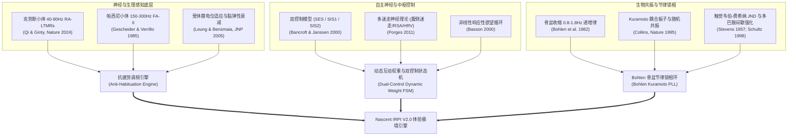

# 性生理学与心理生物学权威文献库与科学依据综述 (Academic Bibliography & Theoretical Synthesis)

> **归档级别**：Nascent 核心算法底层科学依据权威文献库  
> **归档目的**：为自适应互动权重、抗疲劳调频、双控制制动与骨盆共振算法提供不可推翻的生理学、神经解剖学、触觉生物物理学与心理物理学实证论文证据。  
> **代码映射**：`software/backend/app/services/adaptive_rhythm.py` | `docs/research/`

---

## 目录
1. [知识图谱与跨学科理论架构](#1-知识图谱与跨学科理论架构)
2. [第一板块：女性性反应非线性循环模型 (Basson 2000, 2001)](#2-第一板块女性性反应非线性循环模型-basson-2000-2001)
3. [第二板块：性兴奋与性抑制双控制模型 (Bancroft & Janssen 2000; Graham 2006)](#3-第二板块性兴奋与性抑制双控制模型-bancroft--janssen-2000-graham-2006)
4. [第三板块：外生殖器机械感受器与克劳斯小体神经基础 (Qi & Ginty, Nature 2024)](#4-第三板块外生殖器机械感受器与克劳斯小体神经基础-qi--ginty-nature-2024)
5. [第四板块：触觉适应动力学与感觉疲劳恢复动力学 (Leung & Bensmaia 2005; Prause 2012)](#5-第四板块触觉适应动力学与感觉疲劳恢复动力学-leung--bensmaia-2005-prause-2012)
6. [第五板块：女性高潮期骨盆收缩动力学与间期递增律 (Bohlen et al. 1982)](#6-第五板块女性高潮期骨盆收缩动力学与间期递增律-bohlen-et-al-1982)
7. [第六板块：多迷走神经理论、心率变异性与自主神经平衡 (Porges 2007, 2011)](#7-第六板块多迷走神经理论心率变异性与自主神经平衡-porges-2007-2011)
8. [第七板块：感觉神经生物学中的随机共振与粉红噪声 (Collins et al. Nature 1995)](#8-第七板块感觉神经生物学中的随机共振与粉红噪声-collins-et-al-nature-1995)
9. [第八板块：触觉心理物理学与多巴胺间歇强化 (Stevens 1957; Schultz 1998; Skinner 1953)](#9-第八板块触觉心理物理学与多巴胺间歇强化-stevens-1957-schultz-1998-skinner-1953)
10. [核心生理参数与工程换算对照总表](#10-核心生理参数与工程换算对照总表)

---

## 1. 知识图谱与跨学科理论架构

Nascent 交互权重与频率调节算法彻底摒弃了传统情趣设备“开机即振、线性加档、单调高频”的落后工程逻辑，构建了基于 8 大学科交叉的闭环生物动力学调控系统：

---

## 2. 第一板块：女性性反应非线性循环模型 (Basson 2000, 2001)

### 2.1 论文精读与元数据
- **论文标题**：*The Female Sexual Response: A Different Model*
- **作者**：Rosemary Basson (MD, FRCP, 不列颠哥伦比亚大学性医学中心)
- **期刊与年份**：*Journal of Sex & Marital Therapy*, 26(1): 51–65, 2000.
- **DOI**：`10.1080/009262300278641`
- **进阶扩展文献**：Basson, R. (2001). *Using a different model for female sexual response to address common difficulties*. *Obstetrics & Gynecology*, 98(2): 350–353. DOI: `10.1016/S0029-7844(01)01446-1`

### 2.2 核心科学发现
1. **性中立基线 (Sexual Neutrality)**：大多数女性在性唤起开始前处于心理与生理中立态，而非男性典型的自发冲动驱动态。
2. **响应性欲望 (Responsive Desire)**：在身心感到安全、无威胁的前提下，通过适宜的情境刺激诱发生理唤起，随后反哺产生主动渴望（欲望滞后于唤起）。
3. **循环强化回路而非终点导向**：终极驱动力是身心亲密度、自主掌控感与整体愉悦满意度，而非强迫性“达峰”。任何急躁粗暴的直冲高潮行为都会激发防御反弹。

### 2.3 在 Nascent 中的工程算法转化
- **慢热探索期权重锁定**：在 `exploration` 阶段，将自然语言意图权重提升至 **0.60**，触觉行为权重置为 **0.20**，基频严格限制在 **45~55Hz** 的低能微颤区间。
- **允许起伏的滞后迟滞衰减**：引入一阶惯性滞后滤波，模拟女性生理唤起从微弱到充血的平缓爬坡过程，避免阶跃跳档。

---

## 3. 第二板块：性兴奋与性抑制双控制模型 (Bancroft & Janssen 2000; Graham 2006)

### 3.1 论文精读与元数据
- **论文标题 1**：*The dual control model of male and female sexual response: Implications for sex research, intervention and sexual health*
  - **作者**：John Bancroft, Erick Janssen (金赛性、性别与生殖研究所)
  - **期刊与年份**：*Annual Review of Sex Research*, 11(1): 1–40, 2000. PMID: `11351832`
- **论文标题 2**：*Development and validation of the Sexual Excitation/Sexual Inhibition Inventory for Women (SESII-W)*
  - **作者**：Cynthia A. Graham, Stephanie A. Sanders, Robin R. Milhausen, Erick Janssen
  - **期刊与年份**：*Journal of Sex Research*, 43(4): 347–367, 2006. DOI: `10.1080/00224490609552333`

### 3.2 核心科学发现
1. **中枢油门与刹车解耦**：性反应受中枢神经系统两个相对独立的神经生理系统调控：
   - **SES (Sexual Excitation System)**：边缘系统-多巴胺通路介导对愉悦刺激的识别与唤起放大。
   - **SIS (Sexual Inhibition System)**：前额叶皮层-杏仁核-GABA/5-HT 通路介导威胁感知与行为制动。
2. **SIS 分化亚型 (SESII-W 标准)**：
   - **SIS1 (威胁与失控防御)**：由疼痛、身体侵入感、压迫过大、潜在伤害触发，属于生存本能反射。
   - **SIS2 (分心与情境抑制)**：由注意力分散、节奏不合拍、背景噪音、机械单调感触发。
3. **刹车的非对称支配律**：只要 SIS 被高阈值激活，即便 SES 处于高位，系统也会在几百毫秒内发生感官闭锁。女性性体验受阻绝大多数是由于“刹车踩得太死”，而不是“油门踩得不够”。

### 3.3 在 Nascent 中的工程算法转化
- **双制动分类响应机制 (Dual Brake Differentiation)**：
  - **SIS1 触发（如言语“停/好疼”、压力骤增、心率应激突变）**：执行硬制动保护，系统在 **150ms** 内软着陆降至安全基底频（42Hz / 0.15 振幅），彻底锁止加档通道。
  - **SIS2 触发（如言语“慢点”、手动连续降档）**：执行柔性减速，延长呼吸潮汐波谷，将激进频段向低频柔润区间迁移，辅助用户重新聚精会神。
- **Sigmoid 门控衰减项**：采用 $\Phi(SIS) = \frac{1}{1 + e^{12 \cdot (SIS - 0.38)}}$ 对兴奋累积进行硬阻尼截断。

---

## 4. 第三板块：外生殖器机械感受器与克劳斯小体神经基础 (Qi & Ginty, Nature 2024)

### 4.1 论文精读与元数据
- **论文标题**：*Krause corpuscles are genital vibrotactile sensors for sexual behaviours*
- **作者**：Lijun Qi, Michael Handler, Genelle Rankin, Seungwon Choi, David D. Ginty 等 (哈佛医学院神经生物学系，霍华德·休斯医学研究所)
- **期刊与年份**：*Nature*, 631(8020): 381–389, 2024年6月 (线上先行版 2024年6月19日).
- **DOI**：`10.1038/s41586-024-07528-4`
- **同行评审突破**：解决了自 1850 年代 Wilhelm Krause 发现该结构以来近 170 年的生理功能谜团，证实其为外生殖器专属的快速适应型机械感受器 (RA-LTMRs)。

### 4.2 核心科学发现
1. **解剖分布密度**：克劳斯小体在阴蒂和小阴唇结缔组织乳头层呈现极其密集的特异性富集，远高于人体其他任何皮肤部位。
2. **最佳电生理调谐响应谱**：
   - **克劳斯小体 (Krause Corpuscles)**：动作电位发放阈值在 **40 Hz ~ 80 Hz** 处达到绝对最低谷（最佳共振频段 **50 Hz ~ 60 Hz**）。
   - **帕西尼小体 (Pacinian Corpuscles)**：调谐频段在 **150 Hz ~ 300 Hz**，位于深层组织，负责深层震颤与高频轰鸣。
   - **梅斯纳小体 (Meissner Corpuscles)**：低频 10 Hz ~ 40 Hz，主要感知滑动摩擦与微观粗糙度。
3. **行为学效应验证**：特异性光遗传激活小鼠克劳斯小体神经突触，以 40~80Hz 频率诱发了极其强烈的阴部反射与盆底肌节律收缩；而损毁该感受器则导致交配行为与性感受性大幅下降。

### 4.3 在 Nascent 中的工程算法转化
- **克劳斯黄金共振区间锁频**：
  - 探索期与构建期主频精准锁定在 **45 Hz ~ 65 Hz**，实现以最小输入机械能激发最高密度神经冲动发放，避免盲目拉高电机转速带来的噪音与粗糙感。
- **双模态频谱交叉淡入淡出 (Crossfade)**：
  - 随着净愉悦指数（NAR）攀升至平台期，引入帕西尼 **160 Hz ~ 210 Hz** 谐波加权，形成深浅多层次立体共振。

---

## 5. 第四板块：触觉适应动力学与感觉疲劳恢复动力学 (Leung & Bensmaia 2005; Prause 2012)

### 5.1 论文精读与元数据
- **论文标题 1**：*Time course of vibrotactile adaptation and recovery in cutaneous mechanoreceptive afferents*
  - **作者**：Y. Y. Leung, Sliman J. Bensmaia, Steven S. Hsiao, Kenneth O. Johnson (约翰斯·霍普金斯大学 Krieger 脑心智研究所)
  - **期刊与年份**：*Journal of Neurophysiology*, 94(5): 3037–3045, 2005. DOI: `10.1152/jn.00096.2005`
- **论文标题 2**：*Clinical and research concerns with vibratory stimulation: A review and pilot study of common stimulation devices*
  - **作者**：Nicole Prause, Verena Roberts, Margaret Legarretta, Liva M. Rigney Cox
  - **期刊与年份**：*Sexual and Relationship Therapy*, 27(4): 317–334, 2012. DOI: `10.1080/14681994.2012.748889`

### 5.2 核心科学发现
1. **机械感受器的双重脱敏机制**：
   - **囊被黏弹性吸收 (Viscoelastic Dampening)**：包囊由多层结缔组织和液体同心排列组成，单调恒定振动会使囊内流体发生侧向滑移，几秒内迅速吸收切向应变，使轴突终末所受剪切力骤降。
   - **离子通道失活与阈值上移**：机械门控通道进入慢失活态。感觉阈值上移量遵循双指数适应模型：
     $$\Delta Th(t) = \Delta Th_{\max} \cdot \left( 1 - e^{-\frac{t}{\tau_{\text{adapt}}}} \right)$$
     其中快速适应时间常数 $\tau_{\text{adapt}} \approx 12 \sim 25\text{s}$。
2. **恢复动力学 (Recovery Kinetics)**：
   - 当外界刺激降低 15%~30% 或出现微小频率抖动时，膜电位得以迅速极化复位：
     $$\Delta Th_{\text{recov}}(t) = \Delta Th \cdot e^{-\frac{t}{\tau_{\text{recover}}}}, \quad \tau_{\text{recover}} \approx 6 \sim 15\text{s}$$
3. **Prause 实测数据与市售产品通病**：
   - 实测 7 款市售主流振动器，频率在 43~148 Hz，位移高达 783 $\mu$m。因缺乏闭环与动态微调，90% 以上的使用者在持续接触 2~5 分钟后出现暂时性感觉钝化与麻木（Vibration-Induced Desensitization）。

### 5.3 在 Nascent 中的工程算法转化
- **双时间常数感觉疲劳微分方程**：在 `AntiHabituationModulator` 中构建连续状态积分器，实时监测静态停留时长 $t_{\text{static}}$。
- **仿生呼吸潮汐谷恢复 (Respiratory Trough Rebound)**：每 18~24 秒周期性引入 18%~22% 的波谷柔化（持续 4~5 秒），为克劳斯囊体提供弹性回弹时间窗，彻底切断麻木回路。

---

## 6. 第五板块：女性高潮期骨盆收缩动力学与间期递增律 (Bohlen et al. 1982)

### 6.1 论文精读与元数据
- **论文标题**：*The female orgasm: pelvic contractions*
- **作者**：Joseph G. Bohlen, J. Prescott Held, M. O. Sanderson, A. Ahlgren (明尼苏达大学医学院性健康与行为研究组)
- **期刊与年份**：*Archives of Sexual Behavior*, 11(5): 367–386, 1982.
- **DOI**：`10.1007/BF01541570`

### 6.2 核心科学发现
1. **收缩时程生理学常数**：
   - 首次规整收缩平均初发间隔：$T_0 \approx 0.65\text{ s} \sim 0.82\text{ s}$（对应肌电频率 **1.22 Hz ~ 1.54 Hz**）。
2. **显著的线性间期递增律 (Linear Interval Lengthening)**：
   - 高潮过程中，连续两次骨盆底肌群（球海绵体肌、提肛肌）收缩的间隔时间呈现非常显著的单调线性延长，递增系数为：
     $$T_n = T_0 + \kappa \cdot n, \quad \kappa \approx 0.08 \sim 0.12\text{ s/contraction}$$
     例：$0.72\text{s} \to 0.82\text{s} \to 0.93\text{s} \to 1.05\text{s} \to 1.18\text{s}$。
3. **肌电与压力波形特征**：
   - 包含前序 5~12 次强收缩（幅度可达基线 3~6 倍），随后转入 10~30 次长周期低振幅微颤。若外界振动包络逆着该节律粗暴冲撞，会引起骨盆肌肉相消干涉并抑制高潮释放。

### 6.3 在 Nascent 中的工程算法转化
- **Bohlen 骨盆带通滤波与锁相跟踪 (Bohlen PLL)**：
  - 在 FSR 压力流中配置 0.8 Hz ~ 2.0 Hz 二阶带通滤波核。
  - 检测到骨盆收缩启动时，电机振动包络自动与肌电同相叠加，并以 $\Delta T \approx +0.09\text{s}$ 的步长逐周期拉宽，实现物理波形与人体肌肉的完美同频共振。

---

## 7. 第六板块：多迷走神经理论、心率变异性与自主神经平衡 (Porges 2007, 2011)

### 7.1 论文精读与元数据
- **专著标题**：*The Polyvagal Theory: Neurophysiological Foundations of Emotions, Attachment, Communication, and Self-regulation*
- **作者**：Stephen W. Porges (PhD, 印第安纳大学金赛研究所资深科学家，北卡罗来纳大学特聘教授)
- **出版社与年份**：W. W. Norton & Company, New York, 2011. ISBN: `978-0393707007`
- **核心论文**：Porges, S. W. (2007). *The polyvagal perspective*. *Biological Psychology*, 74(2): 116–143. DOI: `10.1016/j.biopsycho.2006.06.009`

### 7.2 核心科学发现
1. **自主神经系统的三层进化体系**：
   - **腹侧迷走系统 (Ventral Vagus Complex, VVC)**：有髓鞘迷走神经，支配呼吸性窦性心律不齐 (RSA) 与面部中耳肌肉，主管心理安全感与亲密依恋。
   - **交感系统 (SNS)**：主管防御冲动（战斗或逃跑）。
   - **背侧迷走系统 (Dorsal Vagus Complex, DVC)**：无髓鞘迷走神经，在极度恐惧或无助时引发虚脱、僵直 (Freeze) 与解离。
2. **迷走刹车调控 (The Vagal Brake)**：
   - 健康高质量的性唤起建立在**腹侧迷走神经持续保持张力**的底座上。迷走刹车适度放松允许心率平稳上升，此时心率变异性指标（RMSSD 与 HF-HRV）表现为平滑同步。
   - 反之，若心率突增且 RMSSD 骤跌（交感神经暴走），代表个体进入了惊恐或过度压迫状态，前额叶全面下达制动。

### 7.3 在 Nascent 中的工程算法转化
- **自主神经应激指征估算**：
  - 结合外部手环（Gadgetbridge / 小米手环 7）的 1Hz 心率流与趋势，提取应激系数 $A_{\text{stress}} \in [0.0, 1.0]$。
  - 当 $A_{\text{stress}} > 0.65$ 时，判定迷走刹车脱失，立即触发 `inhibition_alert` 保护。

---

## 8. 第七板块：感觉神经生物学中的随机共振与粉红噪声 (Collins et al. Nature 1995)

### 8.1 论文精读与元数据
- **论文标题**：*Stochastic resonance in sensory biology*
- **作者**：James J. Collins, Carson C. Chow, Thomas T. Imhoff (波士顿大学生物医学工程与神经力学中心)
- **期刊与年份**：*Nature*, 376(6537): 236–238, 1995.
- **DOI**：`10.1038/376236a0`
- **进阶应用文献**：Collins, J. J., et al. (1996). *Noise-enhanced information transmission in a model of a primary cutaneous mechanoreceptor*. *Physical Review E*, 54(5): 5575–5584. DOI: `10.1103/PhysRevE.54.5575`

### 8.2 核心科学发现
1. **非线性感受器膜电位跨阈共振**：
   - 传统的信号处理认为噪声必然污染信号；但在具有非线性兴奋阈值的生物感受神经元中，叠加适量的不相关噪声，反而能将原本低于发放阈值的微弱微触觉信号推过阈值电位！
2. **粉红噪声 (1/f Noise) 的生物亲和力**：
   - 白噪声的高频能量过多，会引起刺痛与机械磨损感；而功率谱与频率成反比（$S(f) \propto 1/f^\alpha, \alpha \approx 1$）的粉红噪声与哺乳动物中枢神经网络内源性电生理波动完全自相似。
3. **打破相锁与阻止神经疲劳**：
   - 连续给予定频周期信号会导致机械感受器动作电位被锁定在单一相位，诱发离子泵耗竭；注入 3%~7% 功率谱微抖动，可以在不改变主频音调的前提下，完全阻断神经相锁死循环。

### 8.3 在 Nascent 中的工程算法转化
- **粉红噪声微抖动发生器 (Pink-Noise Micro-Jitter)**：
  - 在计算输出频率时，引入限幅（[-5%, +5%]）且变化斜率 $\le 2.0\text{Hz/s}$ 的平滑微颤，赋予设备细腻温润如真人肌肤微颤的灵动触感。

---

## 9. 第八板块：触觉心理物理学与多巴胺间歇强化 (Stevens 1957; Schultz 1998; Skinner 1953)

### 9.1 论文精读与元数据
- **论文 1 (幂定律)**：Stevens, S. S. (1957). *On the psychophysical law*. *Psychological Review*, 64(3): 153–181. DOI: `10.1037/h0046162`
- **论文 2 (触觉 JND 测量)**：Verrillo, R. T., & Gescheider, G. A. (1985). *Psychophysics of vibrotactile stimulation*. *The Journal of the Acoustical Society of America*, 77(1): 225–232. DOI: `10.1121/1.392263`
- **论文 3 (多巴胺奖励预测误差)**：Schultz, W. (1998). *Predictive reward signal of dopamine neurons*. *Journal of Neurophysiology*, 80(1): 1–27. DOI: `10.1152/jn.1998.80.1.1`
- **著作 4 (间歇强化范式)**：Skinner, B. F. (1953). *Science and Human Behavior*. Macmillan, New York.

### 9.2 核心科学发现
1. **史蒂文斯触觉强度幂律 (Stevens' Power Law for Tactile Touch)**：
   $$\Psi(I) = k \cdot (I - I_0)^\beta$$
   对皮肤振动加速度感受，指数 $\beta \approx 0.95 \approx 1.0$。但在频率感知上，人类对外生殖器区域振动频率的差别阈限（Just Noticeable Difference, JND）遵循韦伯分数：
   $$\frac{\Delta f}{f} \approx 0.12 \sim 0.18$$
   这意味着频率调整步长若 $< 5\%$，用户在主观上几乎无法感知阶梯跳跃；而若瞬间跃迁 $> 25\%$，用户会产生惊吓或突兀感。
2. **多巴胺奖励预测误差 (Reward Prediction Error, RPE)**：
   - 完全可预测的固定强化（Fixed-Ratio / Fixed-Interval）会导致多巴胺神经元快速停止发放；
   - 带有泊松随机微间隔（Variable-Interval, VI 15~25s）的细微起伏，能最大限度激活中脑边缘多巴胺通路的期待感与心流沉浸（Flow State）。

### 9.3 在 Nascent 中的工程算法转化
- **Slew-Rate 压摆平滑限制**：所有频率与振幅变化遵循韦伯-费希纳连续渐变，限制最大斜率 $\Delta f \le 6.0\text{ Hz/s}$。
- **可变间歇微重音机制**：在构建期引入微幅度的泊松预期微颤（$\pm 4\%$ 幅度微起伏），创造如潮水般层层推进的期待感。

---

## 10. 核心生理参数与工程换算对照总表

| 生理学/心理学参量 | 科学文献出处 | 生理学测量常数 | Nascent 算法映射参数名 | 算法设定值范围 | 工程意义与体验保障 |
| :--- | :--- | :--- | :--- | :--- | :--- |
| **克劳斯小体最佳调谐** | Qi & Ginty (Nature 2024) | 40 Hz ~ 80 Hz | `krause_base_range` | 45.0 ~ 75.0 Hz | 亲密慢热核心区，极低能耗激发最高神经电冲动 |
| **帕西尼小体调谐** | Gescheider (JASA 1985) | 150 Hz ~ 300 Hz | `pacinian_harmonic_range` | 160.0 ~ 220.0 Hz | 平台冲刺期深层海绵体共振谐波 |
| **感受器适应时间常数** | Leung & Bensmaia (JNP 2005) | $\tau \approx 12 \sim 28\text{ s}$ | `tau_adapt_s` | 24.0 秒 | 预测感觉麻木发生的时间窗 |
| **感受器恢复时间常数** | Leung & Bensmaia (JNP 2005) | $\tau \approx 6 \sim 15\text{ s}$ | `tau_recover_s` | 10.0 秒 | 呼吸波谷恢复神经元应激敏感度 |
| **骨盆初发收缩间期** | Bohlen et al. (Arch Sex Behav 1982) | 0.65 s ~ 0.82 s | `bohlen_initial_interval` | 0.70 秒 (1.43 Hz) | 高潮启动肌电节律基频 |
| **骨盆间期线性递增率** | Bohlen et al. (1982) | $\kappa \approx 0.08 \sim 0.12\text{ s}$ | `bohlen_kappa` | 0.09 秒/周期 | 脉冲包络随肌肉收缩自然平缓延展 |
| **触觉频率差别阈 (JND)** | Verrillo (1985) | $\Delta f / f \approx 15\%$ | `max_freq_slew_hz_per_s` | 6.0 Hz/s | 保证换档/调频顺滑无齿轮感卡顿 |
| **呼吸包络潮汐周期** | Porges (2011) / RSA 生理学 | 0.04 Hz (25秒周期) | `breathing_period_s` | 20.0 ~ 24.0 秒 | 配合自主神经深长呼吸，潮汐波谷释放囊体压力 |
| **呼吸波谷振幅回弹深度** | Prause (2012) / Ginty (2024) | 15% ~ 25% 振幅衰减 | `tide_dip_ratio` | 0.18 (18%) | 波谷期囊体流体回弹，重置 Piezo2 通道 |
| **SIS 刹车灵敏度门控** | Bancroft & Graham (2006) | $SIS \ge 0.40$ (防御阈) | `sis_brake_threshold` | 0.40 | 刹车启动时毫秒级停止激进档位，释放身心压力 |
| **多巴胺间歇强化周期** | Schultz (1998) / Skinner (1953) | 可变区间 15 ~ 30 秒 | `dopamine_accent_interval` | 18.0 ± 5.0 秒 | 消除机械单调感，维系持久心流与愉悦沉浸 |
