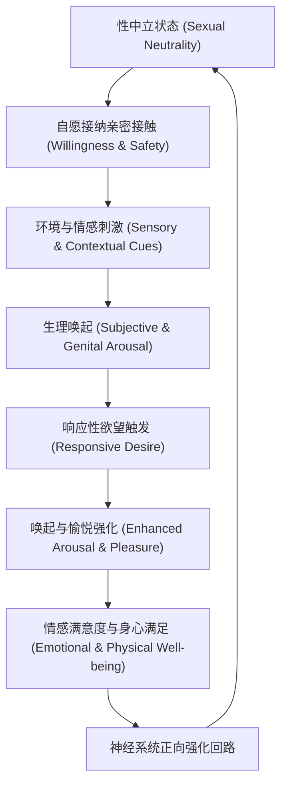

# 女性性反应非线性模型与双控制理论 (Basson & Bancroft)

> **归档类型**：基础神经科学与性心理学生理机制文献归档  
> **关联模块**：`software/backend/app/services/adaptive_rhythm.py` (`DualControlEngine`)  
> **核心学者**：Rosemary Basson (不列颠哥伦比亚大学), John Bancroft & Erick Janssen (金赛研究所)

---

## 1. 核心理论背景与科学范式演进

### 1.1 从传统线性模型到 Basson 非线性循环模型

在 20 世纪下半叶，Masters & Johnson (1966) 以及 Helen Singer Kaplan (1979) 提出了经典的线性性反应周期模型：
$$\text{欲望 (Desire)} \longrightarrow \text{唤起 (Arousal)} \longrightarrow \text{平台期 (Plateau)} \longrightarrow \text{高潮 (Orgasm)} \longrightarrow \text{消退 (Resolution)}$$

然而，临床与实证研究表明，该线性模型主要基于男性生理反应特征，并不符合大多数女性的实际生理与心理体验。2000年，Rosemary Basson 博士发表了划时代的论文：
- **文献出处**：Basson, R. (2000). *The Female Sexual Response: A Different Model*. Journal of Sex & Marital Therapy, 26(1), 51–65. DOI: [10.1080/009262300278641](https://doi.org/10.1080/009262300278641)
- **核心发现**：
  1. **响应性欲望 (Responsive Desire) vs 自发性欲望 (Spontaneous Desire)**：女性往往在初始阶段处于“性中立状态 (Sexual Neutrality)”。欲望通常不是凭空出现的冲动，而是在身心感到安全、亲密连接以及非强迫性的感官接触后，作为“对刺激的响应”而逐渐浮现。
  2. **循环反馈回路 (Circular Feedback Loop)**：性体验的终点并不单纯由“是否达到高潮”来度量，而是由“心理满意度、情感连接、身体舒适度与自主感”共同决定。正向的情感与躯体反馈会强化下一次对亲密接触的接受度；反之，若被强行推进高强度刺激，会导致中枢神经退缩与抑制。
  3. **非单调渐进性**：女性的唤起曲线不是单调上升的斜坡，而是伴随着多次起伏、停顿、探索性舒缓的波浪式动态过程。

---

## 2. 双控制模型 (Dual Control Model: SES & SIS)

由 John Bancroft 与 Erick Janssen (2000) 提出的**双控制模型 (Dual Control Model)** 是现代性神经科学的基石：
- **文献出处**：
  - Bancroft, J., & Janssen, E. (2000). *The dual control model of male and female sexual response: Implications for sex research, intervention and sexual health*. Annual Review of Sex Research, 11(1), 1–40.
  - Graham, C. A., Sanders, S. A., Milhausen, R. R., & Janssen, E. (2006). *Development and validation of the Sexual Excitation/Sexual Inhibition Inventory for Women (SESII-W)*. Journal of Sex Research, 43(4), 347–367.

### 2.1 神经生理学机制：油门与刹车系统

性反应受中枢神经系统的两个相对独立的神经环路调控：
1. **性兴奋系统 (Sexual Excitation System, SES - "油门")**：
   - **神经回路**：边缘系统（伏隔核 NAc、腹侧被盖区 VTA、内侧视前区 mPOA）、下丘脑与交感神经的适度激活。
   - **神经递质**：多巴胺 (Dopamine)、催产素 (Oxytocin)、去甲肾上腺素 (Noradrenaline)、一氧化氮 (NO)。
   - **功能**：识别与响应性线索，激发血管充血与躯体愉悦感。
2. **性抑制系统 (Sexual Inhibition System, SIS - "刹车")**：
   - **神经回路**：前额叶皮层 (PFC)、杏仁核 (Amygdala)、导水管周围灰质 (PAG)。
   - **神经递质**：5-羟色胺 (Serotonin, 5-HT)、$\gamma$-氨基丁酸 (GABA)、皮质醇 (Cortisol)。
   - **女性细分亚型 (SESII-W)**：
     - **SIS1 (威胁与焦虑抑制)**：担忧失控、疼痛、强迫、侵入感或对身体的不安全感。
     - **SIS2 (分心与情境抑制)**：注意力分散、声音过大、节奏机械粗暴、环境压力。

### 2.2 核心洞察：女性愉悦的关键不在于“踩死油门”，而在于“松开刹车”

实证研究表明：
- 男性性反应障碍多由 SES 唤起不足引起；
- **而女性体验受阻（疼痛、麻木、无法沉浸）有超过 80% 是由于 SIS 神经抑制回路过度激活引起的！**
- 若机械振动器在女性 SIS 处于高位时单方面加大振幅与频率，中枢神经会将其识别为**伤害性刺激 (Noxious Stimulus)**，引起盆底肌肉防御性痉挛与感官麻木（Sensory Shut-down）。

---

## 3. 数学建模：自适应双控制状态机方程

基于 Basson 与 Bancroft 的理论，我们为 Nascent 算法引擎构建连续微分方程模型：

### 3.1 兴奋与抑制动态方程

设 $t$ 为互动时间，$E(t) \in [0, 1]$ 为兴奋状态 (SES)，$I(t) \in [0, 1]$ 为抑制状态 (SIS)：

$$\frac{dE(t)}{dt} = \alpha_E \cdot \mathcal{S}_{\text{pleasant}}(t) \cdot (1 - \beta_I \cdot I(t)) - \gamma_E \cdot E(t)$$

$$\frac{dI(t)}{dt} = \alpha_I \cdot \mathcal{S}_{\text{stress}}(t) - \gamma_I \cdot (1 - \mathcal{S}_{\text{stress}}(t)) \cdot I(t)$$

其中：
- $\mathcal{S}_{\text{pleasant}}(t)$：由柔和节奏、适度压力节律与亲密语言构成的正向感官输入。
- $\mathcal{S}_{\text{stress}}(t)$：由突发高压、剧烈心率突增而无节律、语言表达“慢点/有点快”、持续单调高频导致的负向应激输入。
- $(1 - \beta_I \cdot I(t))$：**刹车抑制项**。当 $I(t) \to 1$ 时，兴奋积累效率被强制压制至接近 0。
- $\gamma_E, \gamma_I$：自然衰减半衰期常数（兴奋消退较慢，抑制在确认安全后逐步解除）。

### 3.2 净愉悦沉浸度指数 (Net Arousal Receptivity, NAR)

$$\text{NAR}(t) = \max\left(0, E(t) - \lambda \cdot I(t)^2\right)$$

> **设计要点**：抑制对愉悦的影响是二次非线性的（$\lambda \cdot I(t)^2$）。一旦用户出现焦虑或不适，体验感急剧恶化，算法必须以最高优先级降低驱动档位与频率，释放刹车！

---

## 4. 产品与算法工程落地规范

根据上述科学依据，Nascent 在 `software/backend/app/services/adaptive_rhythm.py` 中制定以下硬性规则：

1. **绝对禁止单向阶梯加速**：严禁出现“每隔 30 秒自动增加一档”的机械逻辑；每个档位的维持与上升必须验证 SIS $\le 0.25$ 且 SES 持续稳定。
2. **负反馈优先权 (Negative Feedback Dominance)**：当用户言语出现犹豫、放慢指令，或传感器检测到突发防御性高压时，系统在 **300ms** 内执行降档与波形柔化（Soft Deceleration），绝不强行维持高频。
3. **响应式平台期设计**：在平台期引入周期性舒缓波（Breathing cycles），维持盆底血流充盈的同时避免持续高负荷激发神经中枢疲劳。
