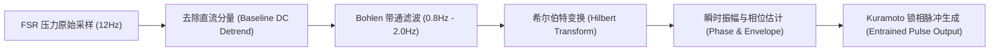

# 盆底肌电节律共振与多迷走神经自主调节 (Bohlen & Porges)

> **归档类型**：神经动力学、自主神经系统生理学与生物反馈工程文献归档  
> **关联模块**：`software/backend/app/services/adaptive_rhythm.py` (`ResonanceEntrainmentFilter`)  
> **核心学者**：Joseph G. Bohlen 等 (明尼苏达大学), Stephen W. Porges (北卡罗来纳大学/印第安纳大学金赛研究所)

---

## 1. 女性高潮期盆底肌肉节律性收缩动力学 (Bohlen et al., 1982)

### 1.1 经典生理测量学突破

在性反应高潮期，会阴球海绵体肌 (Bulbocavernosus)、坐骨海绵体肌 (Ischiocavernosus) 以及提肛肌 (Levator Ani) 会出现强烈的自主与不自主节律性收缩。

1982 年，Joseph G. Bohlen 团队利用高精度压力换能传感器，发表了性学历史上首个高精度量化骨盆收缩特征的研究：
- **文献出处**：Bohlen, J. G., Held, J. P., Sanderson, M. O., & Ahlgren, A. (1982). *The female orgasm: pelvic contractions*. Archives of Sexual Behavior, 11(5), 367–386. DOI: [10.1007/BF01541570](https://doi.org/10.1007/BF01541570)
- **核心生理学定量常数**：
  1. **初发间期 (Initial Intercontraction Interval, $T_0$)**：高潮启动时，首次规整收缩之间的平均时间间隔为 **0.6 秒 ~ 0.8 秒**，对应的肌电收缩基频为：
     $$f_{\text{climax}} = \frac{1}{T_0} \approx 1.25\text{ Hz} \sim 1.67\text{ Hz}$$
  2. **间期线性递增规律 (Linear Interval Lengthening)**：随着高潮阶段的演进，连续收缩之间的间隔呈现极具特征的线性递增，每两次收缩间隔平均延长约 **0.1 秒**：
     $$T_n = T_0 + \kappa \cdot n, \quad \kappa \approx 0.08 \sim 0.12\text{ s/contraction}$$
     例如：第 1 次间隔 0.7s $\to$ 第 2 次 0.8s $\to$ 第 3 次 0.9s $\to$ 第 4 次 1.0s $\to$ 渐趋舒缓。
  3. **收缩类型谱系**：
     - **Type I (规整典型型)**：5~12 次规整的高幅度等间隔收缩，波形高度对称。
     - **Type II (延续型)**：规整收缩后紧接着多达 15~34 次不规则低幅微收缩，持续带来温润余韵。
     - **Type IV (无收缩型)**：极少数个体在主观达到高潮时无外周大肌群剧烈收缩，主要伴随盆底平滑肌微张力变化。

```
+---------------------------------------------------------------------------------------+
| Bohlen 盆底肌收缩波形与间期递增图谱                                                   |
+---------------------------------------------------------------------------------------+
| 压力 (FSR)                                                                           |
|  ^      /\           /\             /\               /\                 /\            |
|  |     /  \         /  \           /  \             /  \               /  \           |
|  |    /    \       /    \         /    \           /    \             /    \          |
|  +---/------\-----/------\-------/------\---------/------\-----------/------\----> t |
|      |<--T0-->|   |<--T1-->|     |<---T2--->|     |<----T3---->|                      |
|       ~0.70s       ~0.80s         ~0.91s           ~1.02s                             |
|      (1.43Hz)     (1.25Hz)       (1.10Hz)         (0.98Hz)                            |
+---------------------------------------------------------------------------------------+
```

---

## 2. 多迷走神经理论与自主神经平衡 (Polyvagal Theory, Porges 2011)

### 2.1 腹侧迷走神经与“安全感中枢” (Ventral Vagus Complex, VVC)

Stephen W. Porges 提出的多迷走神经理论（Polyvagal Theory）深刻揭示了自主神经系统在亲密与防御行为中的分层控制结构：
- **文献出处**：Porges, S. W. (2011). *The Polyvagal Theory: Neurophysiological Foundations of Emotions, Attachment, Communication, and Self-regulation*. W. W. Norton & Company.
- **三层演化系统**：
  1. **腹侧迷走神经系统 (Ventral Vagal System)**：有髓鞘迷走神经，控制心肺、中耳肌肉及面部表情，介导“社会参与系统 (Social Engagement System)”与心理安全感。
  2. **交感神经系统 (Sympathetic Nervous System, SNS)**：介导“战斗或逃跑 (Fight-or-Flight)”，心率急升，血管收缩。
  3. **背侧迷走神经系统 (Dorsal Vagal System)**：古老无髓鞘迷走神经，介导极度恐惧下的“僵直与解离 (Freezing & Dissociation)”。

### 2.2 迷走刹车 (Vagal Brake) 与心率变异性 (HRV)

女性身体只有在**腹侧迷走神经主导（感到安全、被尊重与被理解）**的前提下，才可能允许交感神经适度激活并与迷走神经共协同（Vagal Brake Modulation），进入无防御的愉悦与高潮状态。
- **高频心率变异性 (HF-HRV, 0.15~0.40 Hz)**：反映呼吸性窦性心律不齐 (RSA) 及迷走神经张力。
- **生理应激指标**：
  - 若心率 (HR) 上升且 RMSSD（连续差分均方根）保持稳定，代表**健康活跃的生理唤起**；
  - 若心率骤增、RMSSD 暴跌同时伴随交感低频/高频比值 ($LF/HF > 3.0$)，代表**中枢神经触发警觉或惊恐，SIS 刹车紧急踩死**。

---

## 3. 算法模型：Kuramoto 耦合振子双向夹带同步模型 (Entrainment Engine)

传统的电机调速完全由预设固件时序决定，与用户的自主生理节律处于“异步非相干态”。当外界振动频率与体内盆底肌肉收缩周期错位时，会引发**相消干涉 (Destructive Interference)**，干扰或直接打断高潮进程。

Nascent 引入经典的非线性物理动力学——**藏本模型 (Kuramoto Model)**，实现设备振动包络与人体盆底微收缩的“双向锁相共振”：

### 3.1 动力学方程

设 $\theta_{\text{pelvic}}(t)$ 为通过 FSR 压力带通滤波提取的盆底收缩瞬时相位，$\theta_{\text{toy}}(t)$ 为设备脉冲包络相位：

$$\frac{d\theta_{\text{toy}}(t)}{dt} = \omega_0 + K \cdot \sin\left(\theta_{\text{pelvic}}(t) - \theta_{\text{toy}}(t)\right)$$

其中：
- $\omega_0$：设备基准节律角频率（对应默认 $1.2 \sim 1.4\text{ Hz}$）。
- $K$：耦合强度常数 ($K \in [0.15, 0.35]$)。
- 随着相位差 $\Delta \theta = \theta_{\text{pelvic}} - \theta_{\text{toy}}$ 趋近于 0，设备节律与生理收缩实现微秒级**同相叠加 (Constructive Entrainment)**！

### 3.2 信号处理链：Bohlen 带通滤波器 (0.8 Hz ~ 2.0 Hz)

为了从杂乱的身体位移与基底压力中提取真实的盆底节律性收缩，算法构建二级巴特沃斯 (Butterworth) 带通滤波管道：



1. **基线跟踪器 (DC Detrend)**：以 $\tau = 5.0\text{s}$ 滑动平均提取身体压在设备上的宏观重力，消除体位静止偏置。
2. **带通滤波核**：通带截频为 $0.8\text{ Hz} \sim 2.0\text{ Hz}$，精准捕获 Bohlen 描述的骨盆肌颤基频，彻底滤除手部抖动与高频机电杂音。
3. **相位锁存器**：检测到连续 2 次周期一致性大于 85% 时，标记为“骨盆规整共振启动”，电机包络自动进入 Bohlen 递增跟随模式（每周期延长 ~0.08~0.1s），与身体的节律性高潮共同呼吸起伏！
